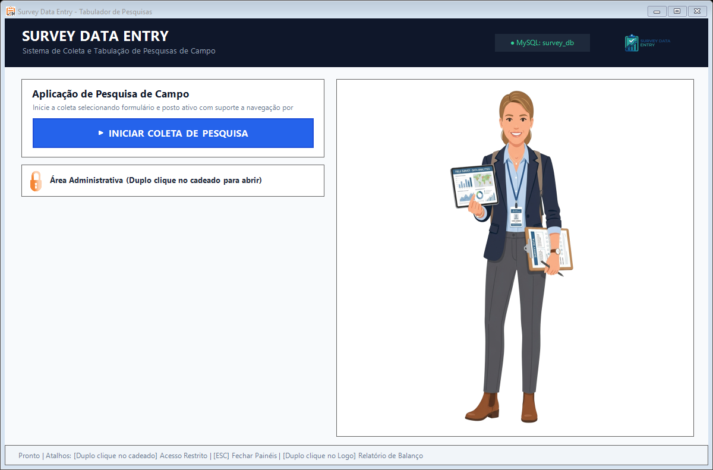
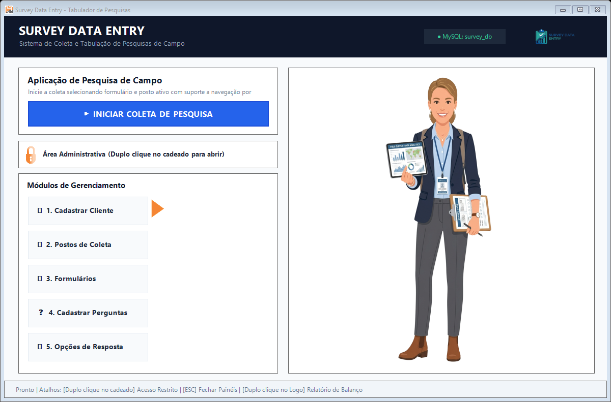

# Historia e Evolucao do Projeto - Survey Data Entry

Este documento registra a trajetoria de desenvolvimento, a memoria tecnica e as transformacoes arquiteturais pelas quais o **Survey Data Entry** passou desde a sua concepcao original em 2014 ate a sua versao atual, refinada e modernizada.

Para consultar a documentacao operacional, guias de compilacao, modelos de dados e telas da versao vigente, acesse o [README Principal](README.md).

---

## 1. Origem e Contexto Historico (2014)

O sistema foi concebido originalmente em **2014** como uma aplicacao desktop desenvolvida sobre a plataforma .NET Framework (C# Windows Forms). Seu proposito primordial era viabilizar operacoes de coleta, controle e tabulacao rapida de pesquisas de campo estruturadas aplicadas presencialmente em unidades de atendimento.

### O Modelo de Desenvolvimento da Epoca

Naquela epoca, o fluxo de desenvolvimento de software desktop apresentava caracteristicas bastante especificas:

- **Construcao Manual de Interfaces**: Telas construidas diretamente no designer visual do Windows Forms, com propriedades estaticas e layouts fixos dimensionados para monitores de resolucao intermediaria.
- **Banco de Dados Relacional Externo**: A aplicacao conectava-se a um servidor MySQL (`survey_db`), que precisava estar instalado, configurado com usuario e senha e em execucao continua no computador do operador ou na rede local da empresa.
- **Comandos SQL Avulsos e Sem Versionamento**: O schema relacional original nao era mantido por ferramentas de migracao automatizada. A modelagem era realizada diretamente no banco e os comandos DDL executados manualmente via utilitarios externos de administracao. Ao longo dos anos e de mudancas de infraestrutura, os scripts originais de criacao do banco de dados foram perdidos, restando apenas as consultas e tabelas inferidas pelo codigo C#.
- **Acesso a Dados Legado**: As operacoes utilizavam o driver `MySql.Data.dll`, empregando predominantemente strings SQL montadas por concatenacao de texto e sem isolamento transacional padronizado.

---

## 2. A Estrutura e Interface Legada

A interface visual do sistema em 2014 refletia os padroes graficos comuns no inicio da decada de 2010, caracterizada por elementos visuais figurativos, paleta de cores saturadas e componentes baseados em texturas de bitmap.

### Componentes Visuais do Software Original

1. **Ilustracao de Personagem / Mascote**: O menu principal continha uma imagem ilustrada de personagem ocupando toda a metade direita do formulario. Embora ilustrativo, esse elemento consumia espaco util de tela sem oferecer funcionalidade operacional ao usuario.
2. **Texturas Bitmap em Botoes**: Botoes de acao utilizavam imagens estaticas em degradê laranja (`btn_01.png`), com cantos arredondados pre-renderizados que sofriam distorcao ao sofrer redimensionamento.
3. **Tipografia e Cores Saturadas**: Uso da fonte Tahoma em tamanhos elevados (ate 15.75pt em rotulos e botoes), combinado com paineis em tons alaranjados e cinzas.
4. **Configuracao Manual de Conexao**: Uma barra inferior com campo de texto (`txt_localDB`) exigia que o usuario digitasse o IP ou endereco do servidor MySQL para conectar a aplicacao.

### Capturas de Tela da Versao Legada

As imagens a seguir foram preservadas a partir do historico de versoes para documentar o estado original da solucao:

#### Menu Principal Original (Com Mascote e Conexao MySQL)

*Figura 1: Interface principal em configuracao legada, com ilustracao de personagem na area lateral e indicador de conexao ao servidor MySQL.*

#### Menu de Gestao Original (Modulos Administrativos)

*Figura 2: Painel administrativo original revelando os modulos estruturais sobrepostos a interface com ilustracao.*

#### Elementos Graficos Originais

| Botao Legado (Textura Bitmap 2014) | Logotipo Anterior |
|:---:|:---:|
|  |  |
| *Figura 3: Textura bitmap degradê laranja utilizada nos controles.* | *Figura 4: Versao anterior da identidade visual do sistema.* |

---

## 3. Desafios Tecnicos do Modelo Original

A analise tecnica do codigo herdado revelou diversos pontos de atrito que comprometiam a portabilidade, a manutencao e a seguranca da aplicacao:

1. **Ausencia de Scripts de Banco de Dados**: A perda dos scripts SQL originais tornava impossivel a implantacao do sistema em novas estacoes de trabalho sem um trabalho previo de inspecao e engenharia reversa do codigo C#.
2. **Dependencia de Servidor de Banco Externo**: A exigencia de um servico MySQL ativo gerava complexidade desnecessaria para um software cujo proposito principal e o funcionamento offline em estacoes de coleta. Qualquer oscilacao de rede ou parada de servico interrompia a aplicacao.
3. **Risco de Injecao de SQL e Execucoes Redundantes**: Consultas montadas via concatenacao direta de strings abriam margem para falhas e problemas de escape de caracteres especiais. Alem disso, rotinas de leitura executavam chamadas duplicadas (`ExecuteNonQuery()` imediatamente antes de `ExecuteReader()`).
4. **Ausencia de Atomicidade nas Respostas**: O salvamento de um questionario respondido envolvia a gravacao do cabecalho e de multiplos registros de respostas filhas. Sem o uso de transacoes, eventuais travamentos deixavam o banco em estado inconsistente com registros orfaos.
5. **Poluicao Visual da Interface**: A presenca de ilustracoes de personagens e botoes bitmap dificultava o uso continuo por operadores de campo em sessoes prolongadas de digitacao.

---

## 4. A Jornada de Modernizacao e Rebranding

O projeto passou por um processo profundo de refatoracao tecnica e revisao de design, transformando o software legado em uma solucao moderna, segura e com zero dependencia de configuracao externa.

### 4.1 Reconstituicao e Engenharia Reversa do Schema

A partir do mapeamento minucioso de cada classe de modelo (`objeto_*.cs`), metodo de persistencia (`camada_dados.cs`) e formulario da aplicacao, todo o modelo relacional foi reconstituido e documentado em scripts formais:

- `database/01_schema.sql`: Criacao das 11 tabelas com integridade referencial completa e triggers de delecao em cascata.
- `database/02_views.sql`: Views analiticas para consolidacao de dados, contagem por tipo de resposta e balanco geral.
- `database/03_seed_tipos.sql`: Insercao dos tipos fundamentais de resposta e unidades federativas brasileiras.

### 4.2 Migracao para SQLite Embutido (Zero Configuracao)

Para eliminar o atrito de instalacao do MySQL, a camada de acesso a dados foi migrada integralmente para **SQLite** (`System.Data.SQLite.dll` acompanhada dos modulos nativos `SQLite.Interop.dll` para arquiteturas x86 e x64):

- **Auto-inicializacao Inteligente (`ConexaoBD.cs`)**: O sistema agora detecta se o arquivo `survey.db` existe. Em caso negativo, cria o arquivo e executa automaticamente toda a estrutura relacional em milissegundos na primeira execucao, tornando a aplicacao 100% plug-and-play.
- **Transacoes ACID Atômicas**: A gravacao de questionarios preenchidos agora e encapsulada em `SQLiteTransaction`. Caso ocorra qualquer erro no processo, o rollback e disparado automaticamente, preservando a higidez do banco.
- **Parametrizacao Total**: 100% dos comandos SQL foram convertidos para instrucoes parametrizadas (`@param`), eliminando vulnerabilidades de injecao e garantindo o tratamento correto de tipos de dados.
- **Gerenciamento Seguro de Recursos**: Adocao estrita do padrao `using` para conexoes, comandos e data readers, prevenindo vazamentos de memoria ou locks no arquivo de banco.

### 4.3 Rebranding Corporativo e Design Clean

A identidade visual foi completamente reconstruida para entregar uma experiencia operacional limpa e de alto contraste:

- **Eliminacao Definitiva de Personagens / Mascotes**: Remocao de qualquer figura humana ilustrada dos formularios e dos recursos compilados da solucao.
- **Novo Logotipo Minimalista**: Criacao de um emblema institucional com icone de prancheta de pesquisa e tracos geometricos limpos, disponibilizado nos formatos PNG com canal alfa (transparencia) e WebP em `docs/` e `Resources/`.
- **Painel de Controle e Gestao (Dashboard)**: O espaco antes ocupado pela ilustracao na tela principal deu lugar a um painel modular informativo estruturado em tres cartoes:
  1. *01. Estruturacao & Cadastros*: Cadastramento de clientes, formularios e perguntas;
  2. *02. Aplicacao Agil em Campo*: Ativacao do questionario para digitacao rapida via teclado;
  3. *03. Tabulacao & Consolidacao*: Persistencia atomica e balanco estatistico;
  - Um card inferior com monitor permanente em verde exibe o status de ativacao do SQLite local (`survey.db`).
- **Padronizacao Flat de Botoes**: Substituicao dos bitmaps laranjas por botoes planos no padrao corporativo `#2563EB` com texto em branco e feedback de clique.
- **Tipografia Corporativa**: Migracao uniforme para a familia tipografica Segoe UI em todos os modulos.

---

## 5. Comparativo: Versao Legada (2014) vs. Versao Vigente (2026)

| Dimensao | Versao Original (2014) | Versao Refinada (2026) |
|---|---|---|
| **Motor de Banco de Dados** | Servidor MySQL externo (`survey_db`) | SQLite embutido em arquivo local (`survey.db`) |
| **Implantacao e Dependencias** | Exigia instalacao e configuracao de servico MySQL | Zero configuracao; banco e criado na primeira execucao |
| **Seguranca nas Consultas** | Concatencao manual de strings SQL | 100% de consultas parametrizadas com `@param` |
| **Integridade de Gravacao** | Insercoes sequenciais sem controle transacional | Transacoes atomicas com rollback automatico (`SQLiteTransaction`) |
| **Identidade Visual** | Ilustracao figurativa de atendente / personagem | Logotipo corporativo minimalista (PNG e WebP) |
| **Design dos Controles** | Botoes com texturas bitmap degradê laranja (`btn_01.png`) | Botoes planos no estilo Flat corporativo (`#2563EB`) |
| **Tipografia** | Tahoma em tamanhos heterogeneos | Segoe UI padronizada com pesos e hierarquia visual clara |
| **Painel Principal** | Area estatica com imagem de mascote | Dashboard modular com fluxo operacional e status do banco |
| **Portabilidade** | Dependente de configuracao manual de rede e IP | Executavel autonomo e totalmente portatil |
| **Documentacao** | Inexistente (scripts SQL perdidos) | DDL completo versionado, automacao de testes e documentacao tecnica |

---

## 6. Comparacao Visual Lado a Lado

### Menu Principal: Evolucao de Design

| Interface Legada (Com Mascote e Servidor Externo) | Interface Atual (Dashboard Clean e SQLite) |
|:---:|:---:|
|  |  |
| *Visual de 2014: presenca de ilustracao figurativa e indicador MySQL.* | *Visual de 2026: painel de fluxo operacional modular e status do SQLite.* |

### Painel de Gestao Administrativa: Evolucao

| Gestao Legada | Gestao Atual |
|:---:|:---:|
|  |  |
| *Controles administrativos sobrepostos ao painel legado.* | *Controles administrativos integrados ao layout corporativo e responsivo.* |

---

## 7. Retorno a Documentacao Principal

Para obter detalhes completos sobre os modulos do sistema, o modelo relacional de tabelas, o guia de compilacao via Visual Studio ou MSBuild, e as capturas de tela de todos os formularios de cadastro e resposta, consulte o documento principal:

-> **[Acessar o README Principal da Aplicacao](README.md)**
