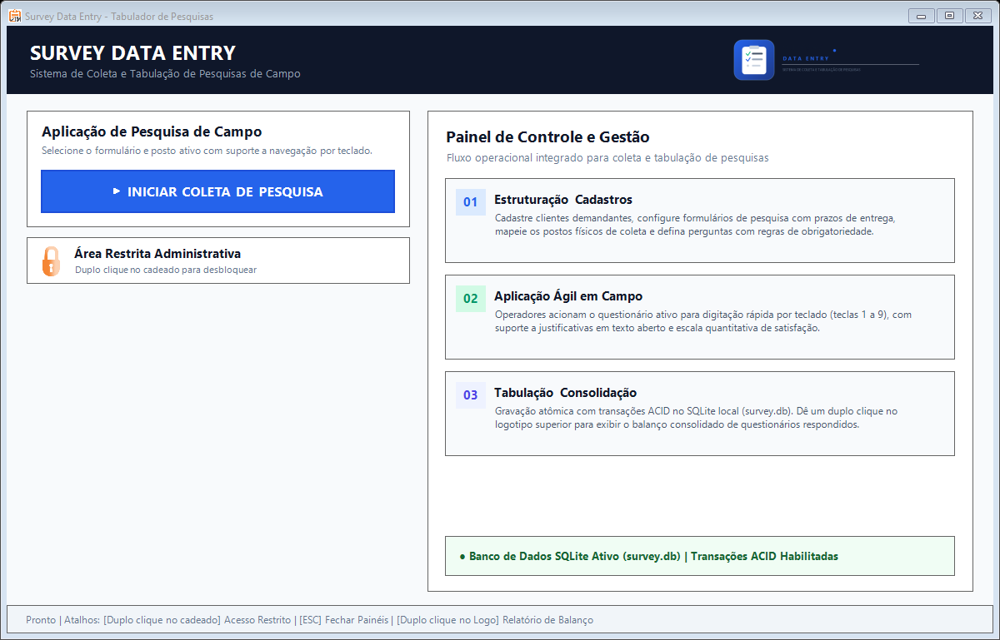
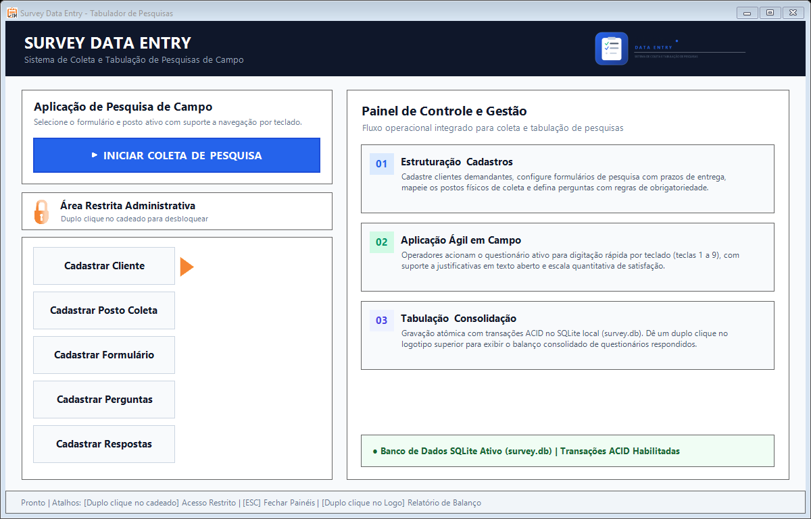
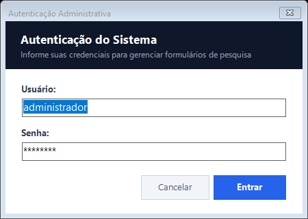
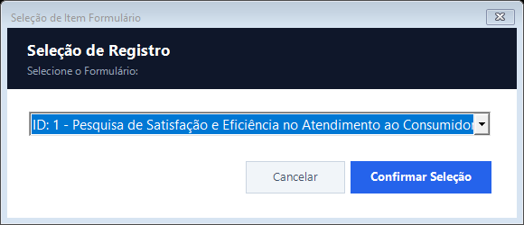
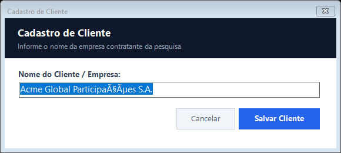
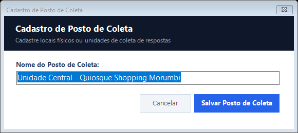
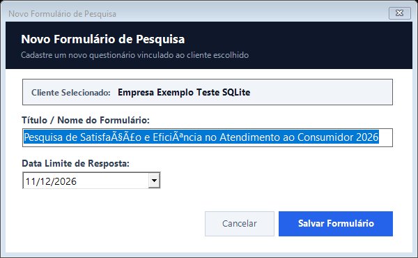
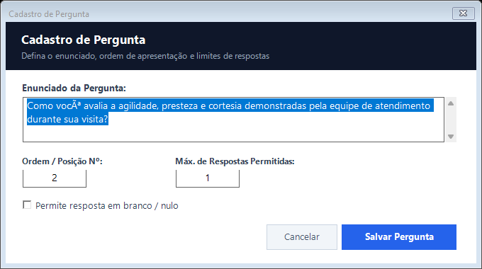
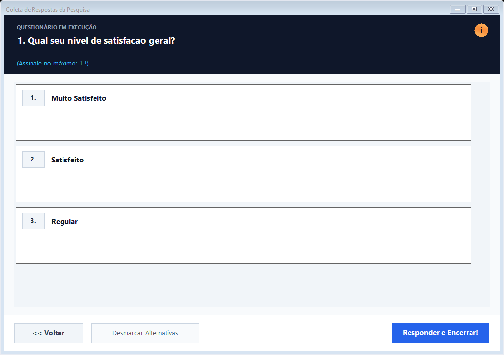

# Survey Data Entry


Sistema desktop desenvolvido em Windows Forms (C# / .NET Framework) integrado ao banco de dados SQLite para modelagem, coleta de campo, controle operacional e tabulação analítica de pesquisas qualitativas e quantitativas.

---

## 1. Visão Geral

O Survey Data Entry gerencia o ciclo completo de operações de pesquisas presenciais: desde o cadastramento de formulários e questionários estruturados até a aplicação das entrevistas em postos de coleta e a consolidação dos resultados tabulados.

A arquitetura utiliza o banco de dados embutido **SQLite**, eliminando a necessidade de instalação ou configuração de servidores de banco de dados externos (como MySQL ou SQL Server). O sistema realiza a auto-inicialização da estrutura relacional (tabelas, índices, triggers, views e dados estruturais) logo na primeira inicialização caso o arquivo do banco de dados ainda não exista.

A camada de persistência opera com comandos SQL parametrizados e controle transacional atômico (ACID), garantindo total integridade dos dados durante a aplicação e envio de questionários. A interface do sistema adota identidade visual limpa e profissional, sem ilustrações ou figuras de personagens, com logotipo moderno disponibilizado nos formatos PNG e WebP.

---

## 2. Principais Funcionalidades

- **Banco de Dados Embutido (Zero Configuração)**: Opera sobre arquivo local SQLite (`survey.db`), permitindo portabilidade total do executável sem instalação de serviços de banco de dados.
- **Auto-inicialização de Estrutura**: Criação automática do schema relacional, views analíticas e dados sementes (seed) na primeira execução.
- **Identidade Visual Clean**: Design corporativo focado em usabilidade, com novo logotipo minimalista (PNG e WebP) e ausência de ilustrações ou figuras de personagens.
- **Painel Informativo Integrado**: Exibição estruturada do fluxo de trabalho na tela principal (Estruturação, Coleta e Tabulação) com monitor de status do banco.
- **Gestão de Clientes Solicitantes**: Cadastro e manutenção de clientes demandantes de pesquisas.
- **Estruturação de Formulários**: Criação de questionários associados a clientes com prazos de entrega e controle de status.
- **Definição Dinâmica de Perguntas**: Suporte a ordem/sequência de apresentação, obrigatoriedade de preenchimento e limite máximo de alternativas assinaladas.
- **Tipos de Resposta Suportados**:
  - Escolha única sem campo aberto.
  - Escolha única com campo dissertativo (texto complementar livre).
  - Múltipla escolha quantitativa / escala de avaliação (graus de intensidade).
- **Controle de Postos de Coleta**: Mapeamento de unidades e locais físicos de coleta de dados.
- **Módulo de Aplicação de Pesquisas**: Interface de preenchimento ágil para operadores com suporte a navegação rápida por teclado e autocompletar.
- **Controle Transacional de Gravação**: Gravação atômica do questionário e de suas respostas filhas via transações SQLite (`SQLiteTransaction` com commit/rollback automático).
- **Consolidação e Tabulação de Resultados**: Views SQL para apuração estatística e contagem de respostas agrupadas por tipo.
- **Área Restrita Administrativa**: Acesso protegido por autenticação para gestão estrutural do sistema.
- **Configuração Flexível do Caminho do Banco**: Ajuste do local do arquivo SQLite diretamente pela interface ou pelo arquivo de configuração.

---

## 3. Interface do Sistema

A interface gráfica do sistema adota tipografia corporativa padronizada (Segoe UI), layout baseado em cartões modulares, contraste visual aprimorado e botões planos de alta usabilidade, eliminando elementos legados desproporcionais e garantindo velocidade de digitação para operadores de campo.

### 3.1 Painel Principal (Dashboard)

A tela principal centraliza os indicadores operacionais do sistema, atalhos de inicialização de pesquisas, o indicador de status do SQLite e o acesso ao painel de gestão. O painel central direito apresenta o fluxo de trabalho detalhado do sistema em três etapas objetivas.


*Figura 1: Dashboard principal do operador com fluxo operacional e acionamento de pesquisas.*


*Figura 2: Dashboard com módulo administrativo desbloqueado para gerenciamento estrutural.*

### 3.2 Modais de Autenticação e Seleção

O controle de acesso administrativo e as rotinas de seleção utilizam caixas de diálogo modais compactas, com cabeçalho contrastante e foco automático nos campos de entrada.

| Autenticação Administrativa | Seleção de Registros |
|:---:|:---:|
|  |  |
| *Figura 3: Modal de autenticação para desbloqueio da área restrita.* | *Figura 4: Seletor universal de clientes, formulários e perguntas.* |

### 3.3 Formulários de Cadastro e Gestão Estrutural

As telas de cadastramento foram redimensionadas para proporções ergonômicas, facilitando o preenchimento sem dispersão visual:

| Cadastro de Clientes | Cadastro de Postos de Coleta |
|:---:|:---:|
|  |  |
| *Figura 5: Registro de clientes demandantes de pesquisas.* | *Figura 6: Mapeamento de unidades e postos de coleta.* |

| Cadastro de Formulários | Configuração de Perguntas |
|:---:|:---:|
|  |  |
| *Figura 7: Definição de questionários e datas limites.* | *Figura 8: Parametrização de perguntas, ordem e regras.* |

### 3.4 Aplicação e Finalização de Questionários

O fluxo de coleta de dados foi projetado para máxima velocidade de entrada via teclado, com cartões de alternativas destacados, suporte a justificativas em texto aberto e escala de avaliação quantitativa:


*Figura 9: Interface de coleta com alternativas interativas, indicadores visuais de seleção e navegação rápida.*


*Figura 10: Confirmação de encerramento da entrevista e persistência segura no banco de dados local.*

---

## 4. Pré-requisitos

Para compilação e execução do projeto em ambiente Windows:

- **Sistema Operacional**: Windows 7 SP1, Windows 8, Windows 10, Windows 11 ou Windows Server 2012+
- **.NET Framework**: Versão 4.8 (ou compatível com .NET 3.5+)
- **IDE / Compilador**: Visual Studio 2017 / 2019 / 2022 ou MSBuild v15.0+
- **Driver de Banco de Dados**: `System.Data.SQLite.dll` acompanhado das bibliotecas nativas de interoperabilidade (`x86/SQLite.Interop.dll` e `x64/SQLite.Interop.dll`), já incluídos localmente no projeto em `src/SurveyDataEntry/lib/`.
- **Servidor Externo**: Não aplicável. A aplicação utiliza SQLite nativo embutido, sem necessidade de servidores ou daemons ativos.

---

## 5. Banco de Dados e Inicialização

O sistema foi concebido para ser autônomo. Ao ser iniciado:

1. A classe `ConexaoBD` verifica a existência do arquivo `survey.db` no diretório da aplicação (ou no caminho customizado).
2. Se o arquivo não existir ou estiver vazio, a aplicação executa automaticamente:
   - As instruções DDL de criação de todas as 11 tabelas com chaves primárias autoincrementais, chaves estrangeiras e triggers.
   - As views analíticas de consolidação de questionários.
   - Os dados semente de tipos de respostas e estados brasileiros.
3. As chaves estrangeiras são habilitadas por conexão através de `PRAGMA foreign_keys = ON;`.

### Scripts SQL para Inspeção Manual (`database/`)

Para propósitos de auditoria, testes ou inicialização via utilitário de linha de comando `sqlite3`, os scripts SQL estão versionados no diretório `database/`:

| Arquivo | Descrição |
|---|---|
| `database/01_schema.sql` | Criação das 11 tabelas, índices e triggers de deleção em cascata |
| `database/02_views.sql` | Criação das views analíticas de tabulação e resultados unificados |
| `database/03_seed_tipos.sql` | Inserção dos tipos estruturais de resposta e unidades federativas |

Para recriar a base manualmente pelo utilitário oficial do SQLite:

```bash
sqlite3 survey.db < database/01_schema.sql
sqlite3 survey.db < database/02_views.sql
sqlite3 survey.db < database/03_seed_tipos.sql
```

---

## 6. Configuração da Aplicação

### Configuração do Arquivo de Banco de Dados

Por padrão, a aplicação armazena e lê os dados do arquivo `survey.db` localizado no mesmo diretório do executável. O caminho pode ser alterado no arquivo de configuração `src/SurveyDataEntry/app.config`:

```xml
<connectionStrings>
    <add name="SurveyDbConnection"
         connectionString="Data Source=survey.db;Version=3;Foreign Keys=True;"
         providerName="System.Data.SQLite" />
</connectionStrings>

<userSettings>
    <SurveyDataEntry.Properties.Settings>
        <setting name="serverLocal" serializeAs="String">
            <value>survey.db</value>
        </setting>
        <setting name="bdNome" serializeAs="String">
            <value>survey.db</value>
        </setting>
    </SurveyDataEntry.Properties.Settings>
</userSettings>
```

Também é possível especificar um caminho absoluto diretamente no campo de texto de configuração do menu principal (por exemplo: `C:\Dados\survey.db`) e clicar em **Aplicar!**.

### Credenciais Padrão de Acesso Administrativo

Para liberar os botões de cadastro na tela principal:

- Dê um duplo-clique no ícone de cadeado.
- Usuário: `admin`
- Senha: `admin` (ou `admin123`)

---

## 7. Compilação e Execução

### Via Visual Studio

1. Abra a solução `src/SurveyDataEntry.sln` no Visual Studio.
2. Selecione a configuração desejada (`Debug` ou `Release`) e a plataforma `Any CPU`.
3. Pressione **Ctrl + Shift + B** para compilar a solução.
4. Pressione **F5** para iniciar a execução.

### Via Linha de Comando (MSBuild)

Abra o prompt de comando do Visual Studio ou o PowerShell e execute:

```powershell
msbuild src\SurveyDataEntry.sln /p:Configuration=Release
```

O executável binário final estará disponível em:
`src/SurveyDataEntry/bin/Release/SurveyDataEntry.exe`

Junto ao executável, as pastas `x86/` e `x64/` contendo `SQLite.Interop.dll` serão automaticamente copiadas pelo processo de compilação.

### Geração Automatizada de Capturas de Tela

O repositório inclui um script em PowerShell para geração automatizada dos prints demonstrativos da interface:

```powershell
powershell -ExecutionPolicy Bypass -File scripts\capture_screenshots.ps1
```

As imagens geradas são salvas na pasta `docs/screenshots/`.

---

## 8. Estrutura do Repositório

```
.
|-- .gitignore                  # Regras de exclusao do Git (artefatos, binarios e bases *.db)
|-- README.md                   # Documentacao tecnica do projeto com prints de tela
|-- plano.md                    # Planejamento e registro de execucao de todas as fases
|-- database/                   # Scripts SQL para SQLite
|   |-- 01_schema.sql           # DDL: definicao de tabelas, chaves e constraints
|   |-- 02_views.sql            # Views para tabulacao e consolidacao de respostas
|   `-- 03_seed_tipos.sql       # Dados estruturais iniciais (tipos de resposta, estados)
|-- docs/                       # Documentacao visual e capturas de tela
|   |-- logo_survey.png         # Logotipo clean corporativo (PNG com transparencia)
|   |-- logo_survey.webp        # Logotipo clean corporativo (formato WebP)
|   `-- screenshots/            # Imagens demonstrativas das interfaces do sistema
|-- scripts/                    # Scripts utilitarios e automacao
|   `-- capture_screenshots.ps1 # Automacao para captura off-screen dos formularios
`-- src/                        # Codigo-fonte da aplicacao
    |-- SurveyDataEntry.sln     # Arquivo de solucao do Visual Studio
    `-- SurveyDataEntry/        # Projeto C# Windows Forms (.NET Framework 4.8)
        |-- SurveyDataEntry.csproj # Configuracao de build com referencias ao SQLite
        |-- app.config          # Configuracoes de conexao SQLite
        |-- Program.cs          # Ponto de entrada do executavel
        |-- conexaoBD.cs        # Gerenciamento de conexoes e auto-inicializacao SQLite
        |-- camada_dados.cs     # Camada de acesso a dados (consultas parametrizadas SQLite)
        |-- objeto_*.cs         # Entidades de dominio e modelos de dados
        |-- frm_*.cs            # Formularios de interface com usuario e logica de telas
        |-- resposta.cs         # Controle de usuario para renderizacao de alternativas
        |-- tela_final.cs       # Tela de conclusao da aplicacao de questionario
        |-- lib/                # Dependencias binarias locais
        |   |-- System.Data.SQLite.dll
        |   |-- x64/SQLite.Interop.dll
        |   `-- x86/SQLite.Interop.dll
        |-- Properties/         # Metadados de montagem, recursos e settings
        `-- Resources/          # Ativos visuais corporativos (logo_survey.png, logo_survey.webp)
```

---

## 9. Modelo de Dados Relacional

```
[ cliente_requerente ]
       | 1
       |
       | N
[ formulario_pesquisa ]
       | 1
       |
       | N
[ pergunta_formulario ]     [ coleta_dados_questionario ] <--- [ coleta_posto ]
       | 1                             | 1
       |                               |
       | N                             | N
[ resposta_pergunta ] <-----+      [ coleta_dados_resposta ]
   (tipo_resposta)          |          | 1
                            +----------+
                                       | N
                            [ coleta_dados_resposta_texto ]
```

---
